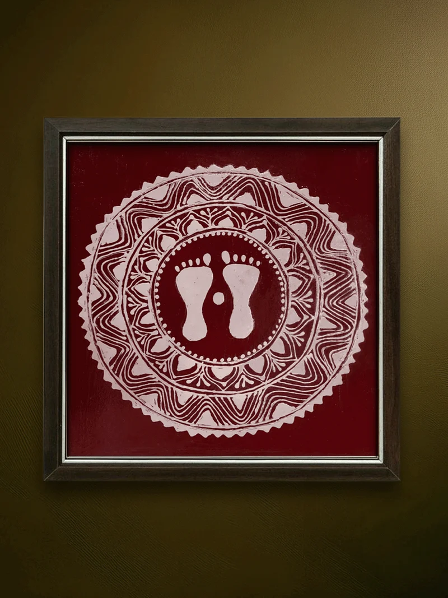

# Contour Extractor

**Turn a photo into clean, customizable line art — then use it as a reference in a browser-based tracing workspace.**

Contour Extractor converts photos of people, animals, and other subjects into black line-art PNGs with a **transparent or white background**. It combines foreground segmentation with a neural line-art detector to produce smooth outlines and recognizable inner details. It includes both a command-line interface and a local **Flask tracing workspace**.

> **Fork note:** Based on the original [contour-extractor by LyreZ61](https://github.com/LyreZ61/contour-extractor). The web tracing workspace is an extension of that project.

## Before & after

| Input photo | Extracted line art |
|:---:|:---:|
|  |  |

The preview above uses `input.png` and `output.png` stored at the repository root. Replace them with your own representative example images before publishing.

## Features

- **Five detail presets:** `detailed`, `medium`, `simple`, `minimal`, and `outline`.
- **Neural line-art extraction:** ControlNet auxiliary `LineartDetector` or `LineartAnimeDetector` for inner strokes.
- **Foreground isolation:** `rembg` models such as U2Net and ISNet for subject silhouettes.
- **Alternative edge styles:** Canny and Sketch/XDoG processing.
- **Adjustable results:** Control stroke thickness, thresholding, mask cleanup, and neural processing resolution.
- **PNG output:** Black strokes on transparent or solid white backgrounds.
- **Local Flask workspace:** Upload a photo, configure extraction settings, and trace using a separate drawing canvas.
- **CLI and batch workflow:** Convert one file or run the supplied batch script over example images.

## How it works

1. **Segment the foreground** with `rembg` to obtain an alpha mask of the subject.
2. **Refine the mask** using morphological closing and opening.
3. **Extract the silhouette** with OpenCV's `cv2.findContours`.
4. **Detect inner strokes** using `LineartDetector` or `LineartAnimeDetector`; Canny and Sketch/XDoG are alternatives.
5. **Clean the line art** with hard thresholding and connected-component filtering.
6. **Export a PNG** with transparent or white background.

The Flask app uses the same `extract_contour` processing engine as the CLI.

## Installation

### Prerequisites

- Python **3.12**
- [uv](https://github.com/astral-sh/uv), recommended for dependency management
- Internet access for initial model-weight downloads

### Clone and install

Clone **your fork** (substitute your GitHub username):

```bash
git clone https://github.com/YOUR_USERNAME/contour-extractor.git
cd contour-extractor

uv venv --python 3.12

# Install the CPU version of PyTorch first.
uv pip install torch torchvision --index-url https://download.pytorch.org/whl/cpu

# Install the remaining dependencies.
uv pip install -r requirements.txt

# Install Flask if it is not already listed in requirements.txt.
uv pip install flask
```

**Note:** On the first neural extraction, model weights are downloaded into the relevant `rembg` and Hugging Face caches. Subsequent runs can reuse those weights locally. Downloads and memory usage depend on the selected models.

## Web tracing workspace

Run the Flask app from the repository root:

**Windows (PowerShell):**

```powershell
.\.venv\Scripts\python.exe app.py
```

**macOS / Linux:**

```bash
.venv/bin/python app.py
```

Open **http://127.0.0.1:5000** in your browser.

In the workspace:

1. Upload an image.
2. Select the extraction style and outline settings.
3. Click **Start tracing**.
4. Use the generated contour as a reference while drawing on the separate canvas.
5. Export your drawing as a transparent PNG or choose a white background.

The reference image and drawing canvas are separate, so the default transparent drawing export does not include the reference outline. The workspace uses randomized names for uploaded and exported files and is designed to clean up temporary files after 24 hours.

For photos or artwork without a suitable isolated foreground, uncheck **Segment foreground subject** and experiment with **Canny** or **Sketch** styles.

> The Flask development server is intended for **local use**. Do not expose it publicly with development/debug settings enabled.

## Command-line usage

**Windows (PowerShell):**

```powershell
.\.venv\Scripts\python.exe contour.py input.jpg output.png
```

**macOS / Linux:**

```bash
.venv/bin/python contour.py input.jpg output.png
```

### Detail levels

Choose one of five presets with `--detail-level`:

| Preset | Result |
|---|---|
| `detailed` | Dense artist-style inner strokes (default preset) |
| `medium` | Fewer strokes while retaining recognizable features |
| `simple` | Main facial or subject features |
| `minimal` | Silhouette with only a few internal hints |
| `outline` | Outer silhouette only |

```bash
# Detailed strokes
.venv/bin/python contour.py photo.jpg out.png --model u2net_human_seg --detail-level detailed

# Medium detail
.venv/bin/python contour.py photo.jpg out.png --model u2net_human_seg --detail-level medium

# Simplified features
.venv/bin/python contour.py photo.jpg out.png --model u2net_human_seg --detail-level simple

# Minimal inner features
.venv/bin/python contour.py photo.jpg out.png --model u2net_human_seg --detail-level minimal

# Silhouette only
.venv/bin/python contour.py photo.jpg out.png --model u2net_human_seg --detail-level outline
```

### Example recipes

```bash
# Default: line art with a transparent background
.venv/bin/python contour.py photo.jpg out.png --model u2net_human_seg

# Printable white background
.venv/bin/python contour.py photo.jpg sketch.png --model u2net_human_seg --background white

# Animal photo
.venv/bin/python contour.py cat.jpg cat_line.png --model isnet-general-use

# Higher neural processing resolution (slower)
.venv/bin/python contour.py photo.jpg out.png --lineart-resolution 768

# Classic Canny extraction
.venv/bin/python contour.py photo.jpg out.png --style canny
```

On Windows, replace `.venv/bin/python` with `.\.venv\Scripts\python.exe` in these examples.

### CLI options

| Flag | Default | Description |
|---|---|---|
| `--model` | `u2net` | Foreground model; e.g. `u2net_human_seg`, `isnet-general-use` |
| `--style` | `lineart` | `lineart`, `lineart-anime`, `canny`, or `sketch` |
| `--detail-level` | None | Detail preset; overrides individual detail settings |
| `--lineart-resolution` | `512` | Neural model working resolution, e.g. `256`, `512`, `768` |
| `--lineart-coarse` | Off | Coarse mode for the `lineart` detector |
| `--background` | `transparent` | `transparent` or `white` |
| `--outer-thickness` | `1` | Outer silhouette stroke width in pixels |
| `--inner-thickness` | `1` | Inner stroke dilation in pixels |
| `--binarize-threshold` | `20` | Keep inner edges above threshold, 0–255 |
| `--inner-close` | `0` | Closing radius to reconnect inner strokes |
| `--min-component-size` | `4` | Remove small isolated components |
| `--canny-low` / `--canny-high` | `30` / `80` | Canny edge thresholds |
| `--alpha-matting` | Off | Improve edges around hair or fur |
| `--mask-close` / `--mask-open` | `4` / `2` | Foreground-mask cleanup radii |
| `--no-inner` | Off | Export silhouette without inner strokes |

### Tuning tips

- **Too much detail?** Choose `simple` or `minimal`, or raise `--binarize-threshold`.
- **Not enough detail?** Choose `medium` or `detailed`, or lower `--binarize-threshold`.
- **Need bolder lines?** Increase `--outer-thickness` and `--inner-thickness` together.
- **Hair or fur edges look rough?** Try `--alpha-matting`.
- **Wrong foreground selected?** Try `--model isnet-general-use` or `--model silueta`.
- **Want a non-neural edge style?** Try `--style canny` or `--style sketch`.

## Batch processing and sample images

The supplied batch script processes `examples/test/*.jpg` and writes transparent and white-background results to `examples/test_out/`.

```bash
./scripts/fetch_test_images.sh
./batch.sh
```

The original project's `examples/test/urls.txt` lists 15 photographs sourced from [Unsplash](https://unsplash.com/), with image use subject to the [Unsplash License](https://unsplash.com/license). See `examples/test_out/` for batch-generated showcase images when available.

## Repository structure

```text
contour-extractor/
├── app.py                       # Flask web application (fork extension)
├── contour.py                   # Core extraction engine and CLI
├── batch.sh                     # Batch processing script
├── requirements.txt             # Python dependencies
├── README.md                    # Project documentation
├── LICENSE                      # MIT license
├── input.png                    # Before image for README showcase
├── output.png                   # After image for README showcase
├── scripts/
│   └── fetch_test_images.sh     # Download example photos
└── examples/
    ├── test/
    │   └── urls.txt
    └── test_out/                 # Example processed images
```

The tree shows the documented core files. Your local Flask implementation may also include additional folders for templates, static resources, and temporary uploads or exports.

## Credits

The contour-extraction pipeline originates from **[LyreZ61/contour-extractor](https://github.com/LyreZ61/contour-extractor)**. This fork adds the local Flask tracing workspace and associated workflow improvements. Core libraries include [rembg](https://github.com/danielgatis/rembg), [OpenCV](https://opencv.org/), and [controlnet-aux](https://github.com/huggingface/controlnet_aux).

## License

Distributed under the [MIT License](LICENSE). Preserve the upstream copyright and license notices when distributing modifications.
